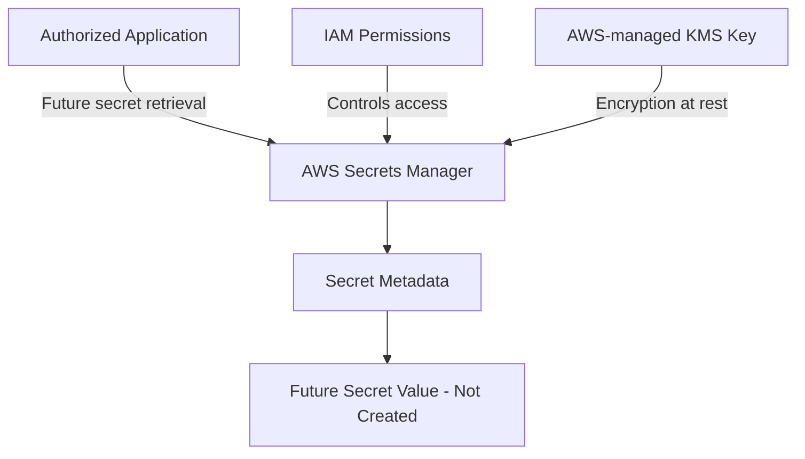
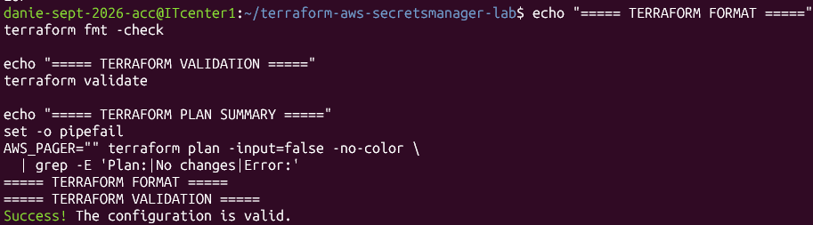

# AWS Secrets Manager Terraform Lab

## Project Overview

This project demonstrates how to design an AWS Secrets
Manager secret using Terraform without storing an actual
password or API token in the Terraform configuration.

**Deployment status: PLANNED ONLY — NOT DEPLOYED**

## Architecture



## Planned AWS Resources

| Resource | Count |
|---|---:|
| Secrets Manager secret | 1 |
| **Total** | **1** |

## Technical Configuration

- AWS Region: us-east-1
- Secret name: terraform-secretsmanager-lab
- Description: Learning lab for AWS Secrets Manager
- Recovery window: 30 days
- Encryption: Default AWS-managed KMS key
- Secret value: Not configured

## Security Design

- No passwords or API tokens in Terraform.
- No secret version resource.
- No sensitive values in Terraform outputs.
- Secret recovery window configured.
- Terraform state files excluded from Git.
- Existing AWS secrets are not modified.

## Security Limitations

- No secret value has been created.
- No application integration has been configured.
- No custom IAM access policy is defined.
- No automatic rotation is configured.
- No live secret retrieval has been tested.

IAM permissions would need to be configured and
validated before a production application could
retrieve the secret.

## Tools

- Ubuntu Linux (WSL2)
- AWS CLI
- Terraform
- Git and GitHub

## Terraform Validation

Commands:

```bash
terraform fmt -check
terraform validate
terraform plan -input=false -no-color
```

Verified results:

- Terraform formatting passed.
- Terraform validation passed.
- Plan: 1 to add, 0 to change, 0 to destroy.

See [Validation Evidence](docs/validation-evidence.md).

## Deployment Status

No terraform apply has been executed.

No Secrets Manager resource has been deployed
through this Terraform project.

## Cost Considerations

Secrets Manager can charge for stored secrets
and API requests.

Review current AWS pricing before deployment.

## Future Improvements

- Create a secret value using a secure workflow.
- Define least-privilege IAM permissions.
- Configure automatic secret rotation.
- Integrate with an AWS application.
- Evaluate customer-managed KMS encryption.
- Add automated security validation.

## Actual Validation Screenshot


