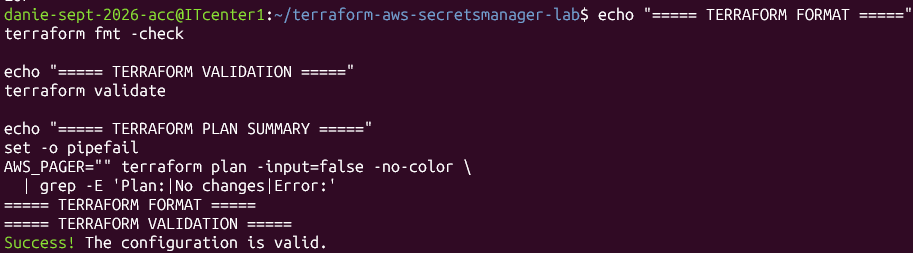

# AWS Secrets Manager Terraform Validation Evidence

## Status

PLANNED ONLY — NOT DEPLOYED

## Environment

- Ubuntu Linux (WSL2)
- Terraform v1.17.0
- AWS Region: us-east-1
- AWS CLI

## Verified Results

terraform fmt -check:
Passed.

terraform validate:
Success! The configuration is valid.

terraform plan:
Plan: 1 to add, 0 to change, 0 to destroy.

## Planned AWS Resources

1. Secrets Manager secret

## Security Configuration

- No actual secret value configured
- Default AWS-managed KMS encryption
- 30-day recovery window
- Terraform state excluded from Git

## Security Limitations

- No secret version created
- No custom IAM policy
- No automatic rotation
- No application integration
- No live secret retrieval testing

## Deployment Status

No terraform apply executed.

No AWS Secrets Manager resource deployed
through this project.

## Screenshot

The screenshot should show real terminal validation results.
